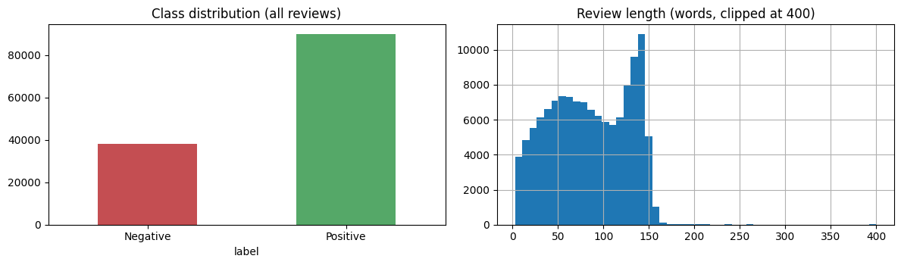
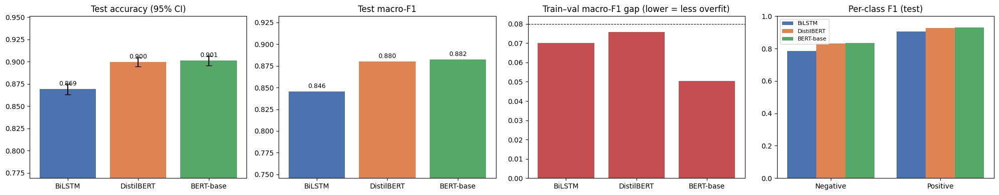
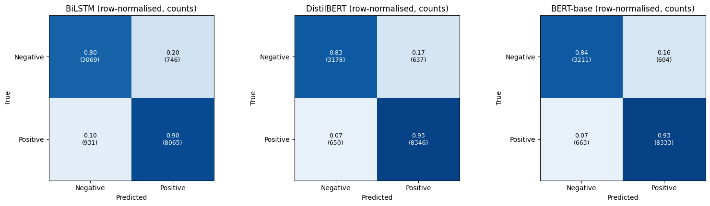
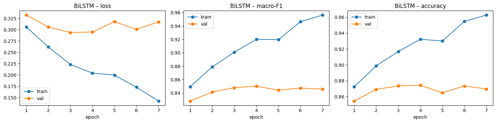
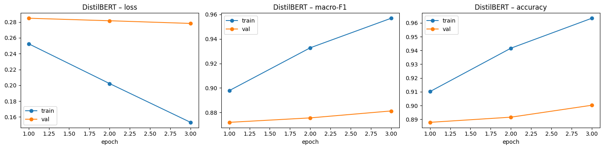
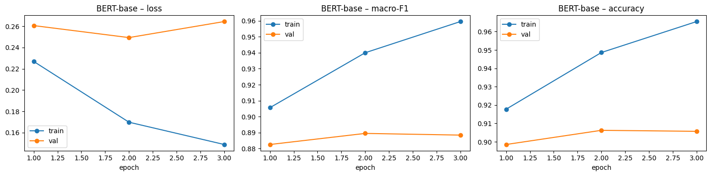

# 💊 Patient Sentiment from Drug Reviews — BiLSTM vs DistilBERT vs BERT-base


**Comparative Analysis of BiLSTM, DistilBERT and BERT-base for Patient Sentiment Classification Using Drug Reviews.** This is a binary sentiment task (Negative vs Positive) on real patient reviews from **Drugs.com**.

> **MAT339 · Transformer Models & Sequence Learning** · MSc Data Science, SASTRA Deemed to be University
> Author: **Priyadharshini Sivasankar** · [Portfolio](https://priyadharshini2002-source.github.io/priyadharshini-data-science-portfolio/)

---

## 📌 Problem
Patients describe how medications work for them in free text. Classifying that sentiment automatically can support **pharmacovigilance**, drug comparison and patient-experience analytics. This project asks whether a recurrent **sequence model** (BiLSTM) is enough, or whether pretrained **transformers** (DistilBERT, BERT-base) give a real and *statistically significant* improvement, and at what cost.

## 🗂️ Data
- **Source:** Drugs.com reviews (UCI / Kaggle `jessicali9530/kuc-hackathon-winter-2018`).
- **Labels:** ratings 1–5 → **Negative**, ratings 6–10 → **Positive**.
- **Cleaning:** 215,063 raw reviews → **128,108** after cleaning and de-duplication (about 70% Positive / 30% Negative).
- **Split:** stratified 80 / 10 / 10 (102,486 / 12,811 / 12,811), keeping the real class distribution and with **no text overlap** between splits.
- **Imbalance:** handled with class weights, and the decision threshold is tuned on validation.



## 🏆 Results (held-out test set, 12,811 reviews)

| Model | Accuracy (±95% CI) | Macro-F1 | Weighted-F1 | Negative-class F1 | Train–val F1 gap | Params (M) | Train time (min) |
|---|---|---|---|---|---|---|---|
| **BERT-base** | **0.901 ± 0.005** | **0.882** | **0.901** | **0.835** | **0.051** | 109.5 | 57.4 |
| DistilBERT | 0.900 ± 0.005 | 0.880 | 0.900 | 0.832 | 0.076 | 67.0 | 28.9 |
| BiLSTM | 0.869 ± 0.006 | 0.846 | 0.870 | 0.785 | 0.070 | 6.3 | **7.3** |

### Statistical significance (paired McNemar test, Bonferroni α = 0.0167)
| Comparison | p-value | Result |
|---|---|---|
| BiLSTM vs DistilBERT | 9.9 × 10⁻²⁹ | ✅ significant |
| BiLSTM vs BERT-base | 2.5 × 10⁻³³ | ✅ significant |
| DistilBERT vs BERT-base | 0.455 | ❌ not significant |

### Key findings
- 🚀 **Transformers clearly beat the BiLSTM.** They gain about 3 points of accuracy and 0.035 macro-F1, and McNemar's test confirms the gain is significant. The biggest improvement is on the minority **Negative** class.
- ⚖️ **DistilBERT is the practical winner.** It is statistically indistinguishable from BERT-base (p = 0.455) while using about 40% fewer parameters and half the training time.
- 🧠 **BERT-base generalises best.** It has the smallest train–validation gap (0.051), so it overfits the least.
- 🔍 **Error analysis.** The remaining mistakes are mostly *mixed* reviews (the drug worked but caused side effects) and borderline ratings around 5–6, where even a human reader could disagree.

## 📊 Screenshots

### Test-set comparison: accuracy (95% CI), macro-F1, overfitting gap, per-class F1


### Confusion matrices


### Learning curves — BiLSTM


### Learning curves — DistilBERT


### Learning curves — BERT-base


## ⚙️ Method
- **BiLSTM:** custom word-level tokenizer (vocabulary about 27.7K) and a bidirectional LSTM trained from scratch in PyTorch, with early stopping on validation.
- **DistilBERT / BERT-base:** `distilbert-base-uncased` and `bert-base-uncased`, both fine-tuned with the same shared recipe for a fair comparison.
- **Evaluation:** accuracy with a 95% CI, macro / weighted precision, recall and F1, per-class reports, confusion matrices, a train–validation overfitting check, paired McNemar tests and error analysis.

## ▶️ How to run
1. Open `Drug_Review_Sentiment_BiLSTM_DistilBERT_BERT.ipynb` in **Google Colab**.
2. Set **Runtime → Change runtime type → T4 GPU**.
3. **Run all.** The notebook downloads the dataset, cleans it, trains all three models and saves the figures and the comparison CSV.

```bash
pip install -r requirements.txt   # only needed to run locally
```

## 📁 Repository structure
```
├── Drug_Review_Sentiment_BiLSTM_DistilBERT_BERT.ipynb   # full notebook with outputs
├── requirements.txt
├── figures/      # EDA, learning curves, test comparison, confusion matrices
└── report/
    └── MAT339_Drug_Review_Sentiment_Report.docx         # project report
```

## 🔗 Related projects
- [Toxic Comment Detection — BiLSTM vs DistilBERT, BERT, RoBERTa & GPT-2](https://github.com/priyadharshini2002-source/toxic_comment_multiEpoch_robust)
- [RL for Adaptive Toxic Content Moderation](https://github.com/priyadharshini2002-source/SARSA-Q-Learning-Expected-SARSA-and-Bandit-Policies-Toxic-Content-Moderation)

---
⭐ Feedback is welcome: [LinkedIn](https://www.linkedin.com/in/priyadharshini-s-921b90421/)
